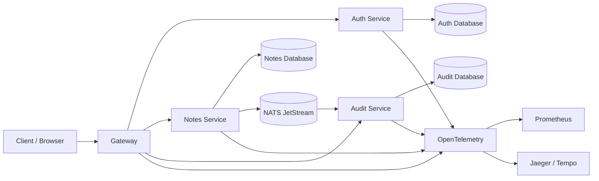

# Go Microservice Starter

This repository is a practical starter project for building a small Go-based microservice system. It is designed to teach the shape of a real distributed application without making the whole system too large or too abstract.

The project includes four main services:

- auth-service: handles user registration, login, refresh tokens, and identity verification
- notes-service: stores user notes and supports create/list/get/update/delete flows
- audit-service: records important events for traceability and review
- gateway: exposes the public API entrypoint and routes calls to the internal services

This is a learning and starter project. It has a good structure for real service boundaries, but it is not a complete production deployment by itself.

## What this repository is trying to model

A typical distributed system usually has these concerns:

- public API entrypoint
- authentication and identity
- service-owned business logic
- per-service data storage
- internal gRPC communication
- event-driven integration for downstream systems
- centralized observability

This repo models exactly those concerns in a small, understandable setup.

## High-level architecture



## Why the project is split this way

Each service owns one business responsibility:

- auth-service owns user identity and tokens
- notes-service owns note data and note operations
- audit-service owns event history
- gateway owns public HTTP access and request routing

This separation keeps the system easier to reason about and safer to evolve.

## Core components

### 1. Root workspace and Go modules

The root workspace is responsible for tying all services together during local development.

- go.work: joins the Go modules in one workspace
- go.mod: root project module metadata
- Makefile: common tasks like proto generation, linting, and testing
- pkg/: shared platform code used by multiple services

### 2. Shared package layer

The pkg directory is intentionally for reusable platform concerns, not business logic.

Examples in this repo include:

- config: environment loading and defaults
- logx: structured logging
- clock: time abstraction for testing
- grpcx and httpx: common request handling primitives
- telemetry: tracing and metrics helpers
- errorsx: shared error wrappers
- eventbus / outbox: event publishing patterns

These packages are meant to avoid duplicating infrastructure work across services.

### 3. Proto contracts

The proto folder is the API contract layer.

- It defines the service interfaces and message shapes
- Generated Go code lives under gen/proto
- gRPC services are created from these contracts
- This keeps service boundaries explicit and versionable

The main contracts currently include:

- auth service proto
- notes service proto
- audit service proto
- shared events proto

### 4. Gateway service

The gateway is the front door of the system.

It is responsible for:

- receiving public HTTP traffic
- validating or forwarding user information
- routing requests to auth, notes, or audit services
- shaping user-facing responses
- passing request metadata such as trace IDs and request IDs

In this starter, the gateway is mostly a bootstrap and config layer, with room to evolve into a richer HTTP API layer.

### 5. Auth service

The auth service owns the user identity domain.

It is responsible for:

- user registration
- login and password validation
- hash generation and comparison using Argon2id-style patterns
- access token and refresh token issuance
- refresh token rotation
- user lookup by ID or email
- logout and token invalidation workflows

This service is the most complete business service in the repo right now.

### 6. Notes service

The notes service owns note data.

It is responsible for:

- creating a note
- reading a note
- listing notes
- updating a note with version checks
- deleting a note
- enforcing a simple optimistic concurrency pattern using version numbers

This service demonstrates the pattern of domain logic plus repository + transport layers.

### 7. Audit service

The audit service owns the event history.

It is responsible for:

- receiving events from other services
- storing immutable audit records
- reading audit events for review or support flows
- preserving a trail of what happened and when

This is the classic downstream consumer pattern for microservices: one service emits events, another records them for observability and accountability.

### 8. Deploy and infra layer

The deploy folder contains deployment-related assets such as Compose or runtime config.

This helps with:

- local orchestration
- service startup ordering
- observability stack
- infrastructure simulation before full production deployment

### 9. Documentation and ADRs

The docs folder and ADR file exist to capture architectural decisions and operational context.

This is very useful because in distributed systems, the important questions are often not just code behavior but also:

- why service boundaries exist
- why an event-driven choice was made
- what trade-offs were deliberately accepted

## Service responsibilities summary

| Component     | Purpose                                  |
| ------------- | ---------------------------------------- |
| gateway       | public API entrypoint and routing        |
| auth-service  | identity, login, session, token handling |
| notes-service | note CRUD and ownership logic            |
| audit-service | immutable record of business events      |
| proto         | API and contract definitions             |
| pkg           | reusable platform components             |
| deploy        | local and deployment runtime config      |
| docs          | design and operational documentation     |

## How a request flows through the system

A typical flow looks like this:

1. A client calls the gateway over HTTP.
2. The gateway routes the request to the right internal service.
3. The target service performs its business logic.
4. The service talks to its own data store or event pipeline.
5. Downstream services like audit may consume events or process related data.
6. Traces and logs flow through observability tools.

Example:

- client creates a note
- gateway routes the request to notes-service
- notes-service validates the request and stores the note
- notes-service emits an event
- audit-service records the event
- telemetry captures the full path across services

## Local development

From the repository root:

```bash
make proto
make up
curl http://localhost:8080/healthz
```

To run tests per service:

```bash
cd services/auth-service && go test ./...
cd services/notes-service && go test ./...
cd services/audit-service && go test ./...
cd services/gateway && go test ./...
```

## Folder map

| Path     | What it does                              |
| -------- | ----------------------------------------- |
| go.work  | joins all Go modules in one workspace     |
| go.mod   | root module metadata                      |
| Makefile | common build, proto, test, and lint tasks |
| pkg      | shared helper code                        |
| proto    | source-of-truth API contracts             |
| gen      | generated protobuf Go code                |
| services | independent service modules               |
| deploy   | infrastructure and runtime config         |
| docs     | design docs and ADRs                      |
| .github  | CI workflows                              |

## Important reality check

This repository is a strong starter architecture, but it is not the same as a hardened production system.

It does not yet fully include:

- production database migration strategy for every service
- full JWT verification and JWKS deployment setup
- real NATS JetStream consumer logic and durable delivery guarantees
- full gateway HTTP handling and security controls
- real operational hardening and secrets management
- full production deployment automation and environment policies

## Best way to use this repo

Use it as:

- a microservice learning project
- a starter architecture for your own Go services
- a reference for clean layer separation and event-driven design
- a base to evolve into a more complete platform

## Summary

This project gives you the structure of a modern service platform without pretending to be a finished production product. That is exactly why it is useful: it teaches the architecture and patterns clearly while still being easy to extend.
