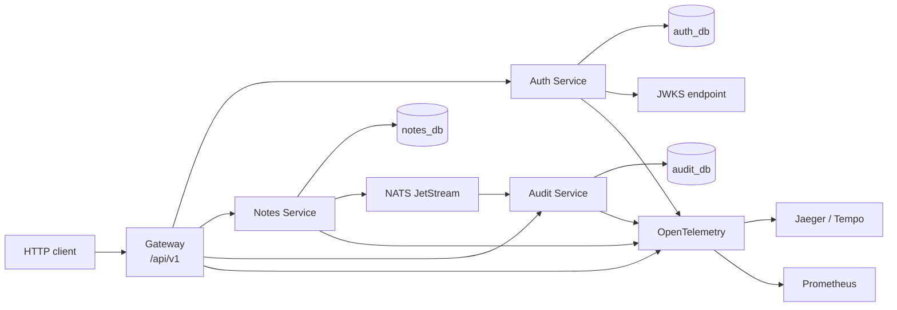
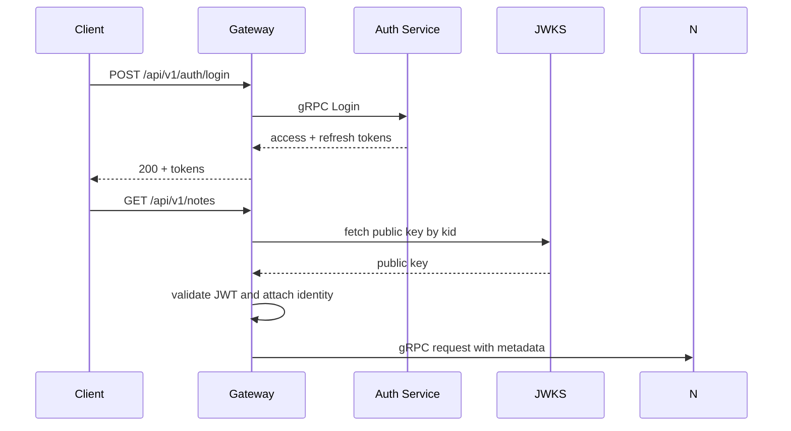

# Go Microservice Starter

This repository is a small, production-oriented microservices starter built in Go. It is designed to help engineers learn the shape of a real distributed system without jumping straight into a large production codebase. The intent is to keep the business domain small and the architecture explicit: authentication, notes, audit, and a public gateway.

## Should you use microservices?

Use microservices when:

- different teams own separate business capabilities
- deployment frequency and rollback needs differ by capability
- each service must scale independently
- the domain is naturally partitioned

Avoid them when:

- the team is small and the domain is still changing quickly
- the system is a single business workflow with few clear service boundaries
- operational complexity is a bigger risk than the code structure itself

For early-stage or team-of-2-to-6 work, a modular monolith is often safer. This starter keeps the service boundaries clear so you can later split them or consolidate them without rewriting the whole platform.

## Features

- 4 independently deployable services: gateway, auth-service, notes-service, audit-service
- gRPC for internal service-to-service calls
- NATS JetStream for event-driven integration
- PostgreSQL per service with raw SQL and migration jobs
- JWT auth with JWKS, refresh token rotation, and Argon2id password hashing
- Slog JSON logging and OpenTelemetry tracing and metrics
- Docker Compose for local observability and service orchestration
- Kubernetes manifests with readiness probes and basic policy structure
- Doc-first design with ADRs and runbooks

## Tech stack and why

- Go 1.26+ for a fast, statically typed service platform with strong tooling
- gRPC + protobuf to define contracts and enforce boundaries between services
- PostgreSQL + pgx for reliable per-service persistence without an ORM layer
- NATS JetStream for asynchronous communication with durable consumers and redelivery
- OpenTelemetry for end-to-end traces and metrics across the request path
- Docker Compose and Kubernetes for local and production-like deployment patterns
- Buf for protobuf linting and breaking-change checks
- Goose for migrations and per-service schema evolution

## Architecture diagram



## Quick start in 3 commands

```bash
make proto
make up
curl -s http://localhost:8080/healthz
```

The full stack includes local PostgreSQL, NATS, and observability containers. The services are arranged to be run together from the root workspace via Docker Compose.

## Smoke test

```bash
curl -sSf http://localhost:8080/healthz
curl -sSf http://localhost:8080/version
```

## Folder-by-folder map

| Path                           | What it is                         | Why it exists                                                        | When you would edit it                              |
| ------------------------------ | ---------------------------------- | -------------------------------------------------------------------- | --------------------------------------------------- |
| [go.work](go.work)             | Go workspace file                  | Ties the modules together for local development                      | When adding a new service module                    |
| [buf.yaml](buf.yaml)           | Buf configuration                  | Enforces protobuf lint and breaking-change policy                    | When adding or revising a contract                  |
| [buf.gen.yaml](buf.gen.yaml)   | Code generation config             | Produces Go stubs from proto files                                   | When adding gRPC or event definitions               |
| [proto](proto)                 | Source-of-truth contracts          | Keeps API definitions versioned and portable                         | When modifying the public or internal contracts     |
| [pkg](pkg)                     | Shared cross-cutting library       | Centralizes logging, config, and common types without business logic | When building reusable platform primitives          |
| [services](services)           | Service modules                    | Holds the independently deployable service applications              | When adding service logic or routes                 |
| [deploy](deploy)               | Deployment assets                  | Local compose and platform manifests                                 | When changing infra behavior or deployment topology |
| [docs](docs)                   | Architecture and operations docs   | Helps developers understand the system and operate it safely         | When documenting decisions or runbooks              |
| [scripts](scripts)             | Helpers for local ops              | Automates cert generation, migrations, seeding, or waiting           | When adding infrastructure helpers                  |
| [tests](tests)                 | Test suite for integration and e2e | Enforces behavior across services                                    | When adding end-to-end or contract tests            |
| [Makefile](Makefile)           | Build automation                   | Makes common tasks easy and consistent                               | When adding new validation targets                  |
| [.golangci.yml](.golangci.yml) | Lint configuration                 | Keeps Go code style and safety checks consistent                     | When adjusting lint rules                           |
| [.env.example](.env.example)   | Example environment file           | Makes local setup easier and documents required settings             | When changing variables                             |
| [README.md](README.md)         | Project overview                   | Provides onboarding and architecture context                         | When updating project shape or usage guidance       |

## Follow one request

A request like POST /api/v1/notes travels like this:

1. The browser or client calls the public gateway at [services/gateway/cmd/gateway/main.go](services/gateway/cmd/gateway/main.go).
2. The HTTP path is routed by the gateway layer, which validates auth, request IDs, and limits.
3. The gateway makes a gRPC call to a notes service method defined in [proto/notes/v1/notes.proto](proto/notes/v1/notes.proto).
4. The notes service validates ownership, writes the note, and records an outbox event.
5. The relay publishes the message to NATS JetStream.
6. The audit service consumes the event from NATS, verifies deduplication, and stores the immutable audit record.
7. The same trace is carried through all steps via OpenTelemetry metadata and a request ID.

## Auth flow



## Port map

| Service            | Port  |
| ------------------ | ----- |
| Gateway HTTP       | 8080  |
| Gateway gRPC       | 9090  |
| Auth service HTTP  | 8081  |
| Auth service gRPC  | 9091  |
| Notes service HTTP | 8082  |
| Notes service gRPC | 9092  |
| Audit service HTTP | 8083  |
| Audit service gRPC | 9093  |
| PostgreSQL         | 5432  |
| NATS               | 4222  |
| Jaeger             | 16686 |
| Prometheus         | 9090  |
| Grafana            | 3000  |

## Makefile reference

| Command             | Purpose                              |
| ------------------- | ------------------------------------ |
| make proto          | generate Go code from protobufs      |
| make proto-lint     | run Buf lint                         |
| make proto-breaking | check for contract breaks            |
| make fmt            | format Go files                      |
| make vet            | run Go static checks                 |
| make lint           | run golangci-lint                    |
| make test           | run unit/integration tests with race |
| make up             | start the Compose stack              |
| make down           | stop the Compose stack               |
| make logs           | follow service logs                  |
| make ci             | full validation pipeline             |

## Testing guide

Use the following commands during local development:

```bash
cd services/auth-service && go test ./...
cd services/notes-service && go test ./...
cd services/audit-service && go test ./...
cd services/gateway && go test ./...
```

This starter intentionally keeps build and lint checks small enough to run frequently while still reflecting production practices.

## Debugging guide

- Use request ID and trace ID in log lines to follow a single request across services.
- Use the OTEL dashboard or Jaeger UI to find a trace by request ID.
- Use the Prometheus metrics endpoint to inspect RED metrics and outbox lag.
- Use pod/service logs with `grep` on `request_id` or `trace_id`.

## Production checklist

- validate env vars at startup
- use TLS and service identities for internal calls
- separate DB and queue per service
- run migrations before the application starts
- pin container base images and avoid running as root
- keep health checks short and dependency-aware
- enable backpressure, rate limiting, and retries only for safe operations

## FAQ

### Why not one database?

Each service owns its data to ensure independent deployment and clean ownership. This avoids hidden coupling and accidental cross-service reads.

### Why use JetStream instead of raw Redis or Kafka?

NATS JetStream offers a small operational footprint with durable streams, consumer acknowledgements, and retry semantics that are easy to reason about for a starter project.

### Why keep business logic out of shared packages?

The shared packages exist for cross-cutting concerns only. Business rules belong in the service layers to avoid hidden coupling and violate service ownership boundaries.

### Is this truly production ready?

This is a solid starter for learning and extension, but production hardening still requires real deployment secrets, operational ownership, disaster recovery procedures, and environment-specific tuning.

## Known limitations

- The starter intentionally keeps the business domain minimal.
- The JWT and mTLS pieces are scaffolded, not a final production certificate setup.
- Compose and Kubernetes configs are templates rather than a full production cluster config.
- The sample API is intentionally small and intentionally boring.

## Next steps

- add a real identity provider and JWKS rotation procedure
- integrate a richer gateway with stricter rate limiting and OpenAPI validation
- create contract and e2e tests against a full compose stack
- expand the outbox and dead-letter handling for more realistic replay workflows
